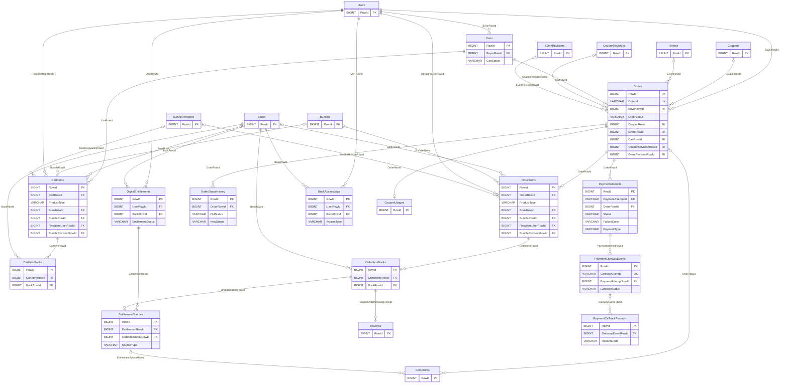
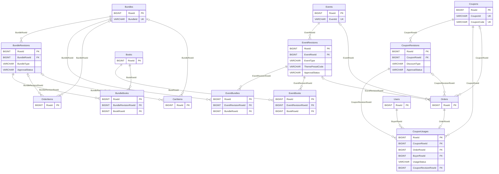
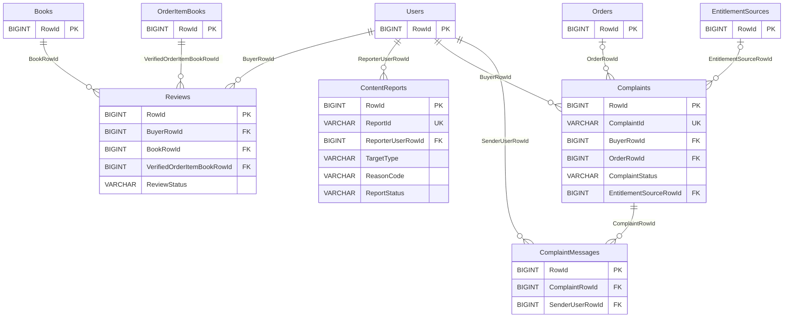
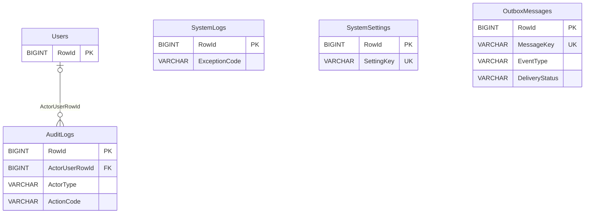

# Sơ đồ quan hệ thực thể (ERD) — Nhà sách PDF

Sinh tự động từ Data Dictionary đặc tả v2.0.3 (khớp với `schema.sql`). GitHub tự hiển thị các khối Mermaid bên dưới.

**Chú thích:** `||--o{` một-nhiều bắt buộc; `|o--o{` một-nhiều tùy chọn (FK cho phép NULL); `||--o|` một-một. Mỗi sơ đồ chỉ hiện khóa chính (PK), khóa ngoại (FK), cột unique (UK) và các cột trạng thái/loại/mã.
Các FK ghi nhận người thao tác lên `Users` (CreatedBy, UpdatedBy, DeletedBy, ApprovedBy, HandledBy...) không vẽ để sơ đồ dễ đọc; chúng vẫn có trong `schema.sql`.

Xem trực tiếp trong SSMS: chạy `schema.sql`, rồi Database Diagrams > New Database Diagram và chọn các bảng của nhóm cần xem.

## 0. Tổng quan toàn hệ thống (53 bảng, chỉ quan hệ)

```mermaid
erDiagram
    Roles ||--o{ RolePermissions : "RoleRowId"
    Permissions ||--o{ RolePermissions : "PermissionRowId"
    Roles ||--o{ Users : "RoleRowId"
    Users ||--o{ UserSessions : "UserRowId"
    Users ||--o{ PasswordResetRequests : "UserRowId"
    Users ||--o{ Notifications : "RecipientUserRowId"
    Publishers |o--o{ Books : "PublisherRowId"
    Books ||--o{ BookFiles : "BookRowId"
    Categories |o--o{ Categories : "ParentCategoryRowId"
    Books ||--o{ BookAuthors : "BookRowId"
    Authors ||--o{ BookAuthors : "AuthorRowId"
    Books ||--o{ BookCategories : "BookRowId"
    Categories ||--o{ BookCategories : "CategoryRowId"
    Books ||--o{ BookImages : "BookRowId"
    Users ||--o{ WishlistItems : "BuyerRowId"
    Books ||--o{ WishlistItems : "BookRowId"
    Users ||--o{ BrowsingHistory : "BuyerRowId"
    Books ||--o{ BrowsingHistory : "BookRowId"
    Users ||--o{ Carts : "BuyerRowId"
    Carts ||--o{ CartItems : "CartRowId"
    Books |o--o{ CartItems : "BookRowId"
    Bundles |o--o{ CartItems : "BundleRowId"
    Users ||--o{ CartItems : "RecipientUserRowId"
    BundleRevisions |o--o{ CartItems : "BundleRevisionRowId"
    CartItems ||--o{ CartItemBooks : "CartItemRowId"
    Books ||--o{ CartItemBooks : "BookRowId"
    Users ||--o{ Orders : "BuyerRowId"
    Coupons |o--o{ Orders : "CouponRowId"
    Events |o--o{ Orders : "EventRowId"
    Carts ||--o| Orders : "CartRowId"
    CouponRevisions |o--o{ Orders : "CouponRevisionRowId"
    EventRevisions |o--o{ Orders : "EventRevisionRowId"
    Orders ||--o{ OrderItems : "OrderRowId"
    Books |o--o{ OrderItems : "BookRowId"
    Bundles |o--o{ OrderItems : "BundleRowId"
    Users ||--o{ OrderItems : "RecipientUserRowId"
    BundleRevisions |o--o{ OrderItems : "BundleRevisionRowId"
    OrderItems ||--o{ OrderItemBooks : "OrderItemRowId"
    Books ||--o{ OrderItemBooks : "BookRowId"
    Orders ||--o{ PaymentAttempts : "OrderRowId"
    PaymentAttempts ||--o{ PaymentGatewayEvents : "PaymentAttemptRowId"
    Orders ||--o{ OrderStatusHistory : "OrderRowId"
    Users ||--o{ DigitalEntitlements : "UserRowId"
    Books ||--o{ DigitalEntitlements : "BookRowId"
    DigitalEntitlements ||--o{ EntitlementSources : "EntitlementRowId"
    OrderItemBooks ||--o| EntitlementSources : "OrderItemBookRowId"
    Users ||--o{ BookAccessLogs : "UserRowId"
    Books ||--o{ BookAccessLogs : "BookRowId"
    BundleRevisions ||--o{ BundleBooks : "BundleRevisionRowId"
    Books ||--o{ BundleBooks : "BookRowId"
    EventRevisions ||--o{ EventBooks : "EventRevisionRowId"
    Books ||--o{ EventBooks : "BookRowId"
    EventRevisions ||--o{ EventBundles : "EventRevisionRowId"
    Bundles ||--o{ EventBundles : "BundleRowId"
    Coupons ||--o{ CouponUsages : "CouponRowId"
    Orders ||--o| CouponUsages : "OrderRowId"
    Users ||--o{ CouponUsages : "BuyerRowId"
    CouponRevisions ||--o{ CouponUsages : "CouponRevisionRowId"
    Users ||--o{ Reviews : "BuyerRowId"
    Books ||--o{ Reviews : "BookRowId"
    OrderItemBooks ||--o{ Reviews : "VerifiedOrderItemBookRowId"
    Users ||--o{ ContentReports : "ReporterUserRowId"
    Users ||--o{ Complaints : "BuyerRowId"
    Orders |o--o{ Complaints : "OrderRowId"
    EntitlementSources |o--o{ Complaints : "EntitlementSourceRowId"
    Complaints ||--o{ ComplaintMessages : "ComplaintRowId"
    Users ||--o{ ComplaintMessages : "SenderUserRowId"
    Users |o--o{ AIConversations : "OwnerUserRowId"
    AIConversations ||--o{ AIMessages : "ConversationRowId"
    AIConversations ||--o{ AIActionLogs : "ConversationRowId"
    Users |o--o{ AIActionLogs : "InitiatorUserRowId"
    AIActionRequests |o--o{ AIActionLogs : "ActionRequestRowId"
    Users |o--o{ AuditLogs : "ActorUserRowId"
    Bundles ||--o{ BundleRevisions : "BundleRowId"
    Events ||--o{ EventRevisions : "EventRowId"
    Coupons ||--o{ CouponRevisions : "CouponRowId"
    Users ||--o{ AIActionRequests : "InitiatorUserRowId"
    AIConversations ||--o{ AIActionRequests : "ConversationRowId"
    PaymentGatewayEvents |o--o{ PaymentCallbackReceipts : "GatewayEventRowId"
```

## 1. Tài khoản, phân quyền và thông báo

Bảng: `Roles`, `Permissions`, `RolePermissions`, `Users`, `UserSessions`, `PasswordResetRequests`, `Notifications`. Bảng liên quan nhóm khác: `AIActionLogs`, `AIActionRequests`, `AIConversations`, `AuditLogs`, `BookAccessLogs`, `BrowsingHistory`, `CartItems`, `Carts`, `ComplaintMessages`, `Complaints`, `ContentReports`, `CouponUsages`, `DigitalEntitlements`, `OrderItems`, `Orders`, `Reviews`, `WishlistItems`

```mermaid
erDiagram
    Roles ||--o{ RolePermissions : "RoleRowId"
    Permissions ||--o{ RolePermissions : "PermissionRowId"
    Roles ||--o{ Users : "RoleRowId"
    Users ||--o{ UserSessions : "UserRowId"
    Users ||--o{ PasswordResetRequests : "UserRowId"
    Users ||--o{ Notifications : "RecipientUserRowId"
    Users ||--o{ WishlistItems : "BuyerRowId"
    Users ||--o{ BrowsingHistory : "BuyerRowId"
    Users ||--o{ Carts : "BuyerRowId"
    Users ||--o{ CartItems : "RecipientUserRowId"
    Users ||--o{ Orders : "BuyerRowId"
    Users ||--o{ OrderItems : "RecipientUserRowId"
    Users ||--o{ DigitalEntitlements : "UserRowId"
    Users ||--o{ BookAccessLogs : "UserRowId"
    Users ||--o{ CouponUsages : "BuyerRowId"
    Users ||--o{ Reviews : "BuyerRowId"
    Users ||--o{ ContentReports : "ReporterUserRowId"
    Users ||--o{ Complaints : "BuyerRowId"
    Users ||--o{ ComplaintMessages : "SenderUserRowId"
    Users |o--o{ AIConversations : "OwnerUserRowId"
    Users |o--o{ AIActionLogs : "InitiatorUserRowId"
    Users |o--o{ AuditLogs : "ActorUserRowId"
    Users ||--o{ AIActionRequests : "InitiatorUserRowId"
    Roles {
        BIGINT RowId PK
        VARCHAR RoleCode UK
    }
    Permissions {
        BIGINT RowId PK
        VARCHAR PermissionCode UK
        VARCHAR ModuleCode
    }
    RolePermissions {
        BIGINT RowId PK
        BIGINT RoleRowId FK
        BIGINT PermissionRowId FK
    }
    Users {
        BIGINT RowId PK
        VARCHAR UserId UK
        BIGINT RoleRowId FK
        VARCHAR AccountStatus
        NVARCHAR NormalizedEmail UK
    }
    UserSessions {
        BIGINT RowId PK
        BIGINT UserRowId FK
        CHAR RefreshTokenHash UK
    }
    PasswordResetRequests {
        BIGINT RowId PK
        BIGINT UserRowId FK
        CHAR TokenHash UK
    }
    Notifications {
        BIGINT RowId PK
        BIGINT RecipientUserRowId FK
        VARCHAR NotificationType
    }
    AIActionLogs {
        BIGINT RowId PK
    }
    AIActionRequests {
        BIGINT RowId PK
    }
    AIConversations {
        BIGINT RowId PK
    }
    AuditLogs {
        BIGINT RowId PK
    }
    BookAccessLogs {
        BIGINT RowId PK
    }
    BrowsingHistory {
        BIGINT RowId PK
    }
    CartItems {
        BIGINT RowId PK
    }
    Carts {
        BIGINT RowId PK
    }
    ComplaintMessages {
        BIGINT RowId PK
    }
    Complaints {
        BIGINT RowId PK
    }
    ContentReports {
        BIGINT RowId PK
    }
    CouponUsages {
        BIGINT RowId PK
    }
    DigitalEntitlements {
        BIGINT RowId PK
    }
    OrderItems {
        BIGINT RowId PK
    }
    Orders {
        BIGINT RowId PK
    }
    Reviews {
        BIGINT RowId PK
    }
    WishlistItems {
        BIGINT RowId PK
    }
```

## 2. Catalog sách PDF

Bảng: `Books`, `BookFiles`, `Authors`, `Publishers`, `Categories`, `BookAuthors`, `BookCategories`, `BookImages`, `WishlistItems`, `BrowsingHistory`. Bảng liên quan nhóm khác: `BookAccessLogs`, `BundleBooks`, `CartItemBooks`, `CartItems`, `DigitalEntitlements`, `EventBooks`, `OrderItemBooks`, `OrderItems`, `Reviews`, `Users`

```mermaid
erDiagram
    Publishers |o--o{ Books : "PublisherRowId"
    Books ||--o{ BookFiles : "BookRowId"
    Categories |o--o{ Categories : "ParentCategoryRowId"
    Books ||--o{ BookAuthors : "BookRowId"
    Authors ||--o{ BookAuthors : "AuthorRowId"
    Books ||--o{ BookCategories : "BookRowId"
    Categories ||--o{ BookCategories : "CategoryRowId"
    Books ||--o{ BookImages : "BookRowId"
    Users ||--o{ WishlistItems : "BuyerRowId"
    Books ||--o{ WishlistItems : "BookRowId"
    Users ||--o{ BrowsingHistory : "BuyerRowId"
    Books ||--o{ BrowsingHistory : "BookRowId"
    Books |o--o{ CartItems : "BookRowId"
    Books ||--o{ CartItemBooks : "BookRowId"
    Books |o--o{ OrderItems : "BookRowId"
    Books ||--o{ OrderItemBooks : "BookRowId"
    Books ||--o{ DigitalEntitlements : "BookRowId"
    Books ||--o{ BookAccessLogs : "BookRowId"
    Books ||--o{ BundleBooks : "BookRowId"
    Books ||--o{ EventBooks : "BookRowId"
    Books ||--o{ Reviews : "BookRowId"
    Books {
        BIGINT RowId PK
        VARCHAR BookId UK
        BIGINT PublisherRowId FK
        VARCHAR LanguageCode
        VARCHAR Status
    }
    BookFiles {
        BIGINT RowId PK
        BIGINT BookRowId FK
        NVARCHAR StorageKey UK
        VARCHAR MimeType
    }
    Authors {
        BIGINT RowId PK
        VARCHAR AuthorCode
    }
    Publishers {
        BIGINT RowId PK
        VARCHAR PublisherCode
    }
    Categories {
        BIGINT RowId PK
        VARCHAR CategoryCode UK
        BIGINT ParentCategoryRowId FK
    }
    BookAuthors {
        BIGINT RowId PK
        BIGINT BookRowId FK
        BIGINT AuthorRowId FK
    }
    BookCategories {
        BIGINT RowId PK
        BIGINT BookRowId FK
        BIGINT CategoryRowId FK
    }
    BookImages {
        BIGINT RowId PK
        BIGINT BookRowId FK
    }
    WishlistItems {
        BIGINT RowId PK
        BIGINT BuyerRowId FK
        BIGINT BookRowId FK
    }
    BrowsingHistory {
        BIGINT RowId PK
        BIGINT BuyerRowId FK
        BIGINT BookRowId FK
    }
    BookAccessLogs {
        BIGINT RowId PK
    }
    BundleBooks {
        BIGINT RowId PK
    }
    CartItemBooks {
        BIGINT RowId PK
    }
    CartItems {
        BIGINT RowId PK
    }
    DigitalEntitlements {
        BIGINT RowId PK
    }
    EventBooks {
        BIGINT RowId PK
    }
    OrderItemBooks {
        BIGINT RowId PK
    }
    OrderItems {
        BIGINT RowId PK
    }
    Reviews {
        BIGINT RowId PK
    }
    Users {
        BIGINT RowId PK
    }
```

## 3. Giỏ hàng, đơn hàng, thanh toán và thư viện

Bảng: `Carts`, `CartItems`, `CartItemBooks`, `Orders`, `OrderItems`, `OrderItemBooks`, `PaymentAttempts`, `PaymentGatewayEvents`, `OrderStatusHistory`, `DigitalEntitlements`, `EntitlementSources`, `BookAccessLogs`, `PaymentCallbackReceipts`. Bảng liên quan nhóm khác: `Books`, `BundleRevisions`, `Bundles`, `Complaints`, `CouponRevisions`, `CouponUsages`, `Coupons`, `EventRevisions`, `Events`, `Reviews`, `Users`

## 4. Bundle, Event, Coupon (revision)

Bảng: `Bundles`, `BundleBooks`, `Events`, `EventBooks`, `EventBundles`, `Coupons`, `CouponUsages`, `BundleRevisions`, `EventRevisions`, `CouponRevisions`. Bảng liên quan nhóm khác: `Books`, `CartItems`, `OrderItems`, `Orders`, `Users`

## 5. Đánh giá, báo cáo vi phạm, khiếu nại

Bảng: `Reviews`, `ContentReports`, `Complaints`, `ComplaintMessages`. Bảng liên quan nhóm khác: `Books`, `EntitlementSources`, `OrderItemBooks`, `Orders`, `Users`

## 6. Trợ lý AI và tri thức

Bảng: `AIConversations`, `AIMessages`, `AIActionLogs`, `KnowledgeArticles`, `AIActionRequests`. Bảng liên quan nhóm khác: `Users`

```mermaid
erDiagram
    Users |o--o{ AIConversations : "OwnerUserRowId"
    AIConversations ||--o{ AIMessages : "ConversationRowId"
    AIConversations ||--o{ AIActionLogs : "ConversationRowId"
    Users |o--o{ AIActionLogs : "InitiatorUserRowId"
    AIActionRequests |o--o{ AIActionLogs : "ActionRequestRowId"
    Users ||--o{ AIActionRequests : "InitiatorUserRowId"
    AIConversations ||--o{ AIActionRequests : "ConversationRowId"
    AIConversations {
        BIGINT RowId PK
        BIGINT OwnerUserRowId FK
        VARCHAR AssistantType
        VARCHAR ConversationStatus
    }
    AIMessages {
        BIGINT RowId PK
        BIGINT ConversationRowId FK
    }
    AIActionLogs {
        BIGINT RowId PK
        BIGINT ConversationRowId FK
        BIGINT InitiatorUserRowId FK
        VARCHAR ActionType
        VARCHAR ConfirmationStatus
        VARCHAR ExecutionStatus
        BIGINT ActionRequestRowId FK
    }
    KnowledgeArticles {
        BIGINT RowId PK
        VARCHAR ArticleCode UK
        VARCHAR ArticleStatus
    }
    AIActionRequests {
        BIGINT RowId PK
        BIGINT InitiatorUserRowId FK
        BIGINT ConversationRowId FK
        BINARY TokenHash UK
        VARCHAR RequestStatus
    }
    Users {
        BIGINT RowId PK
    }
```

## 7. Nhật ký và vận hành

Bảng: `AuditLogs`, `SystemLogs`, `SystemSettings`, `OutboxMessages`. Bảng liên quan nhóm khác: `Users`

